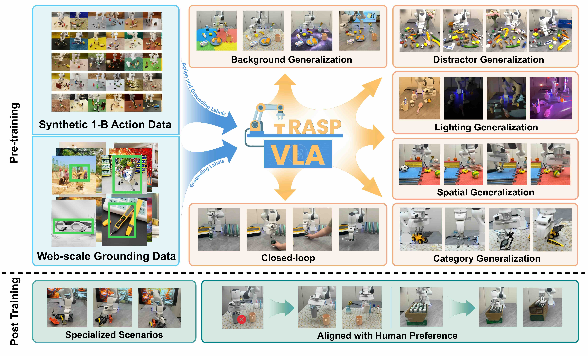
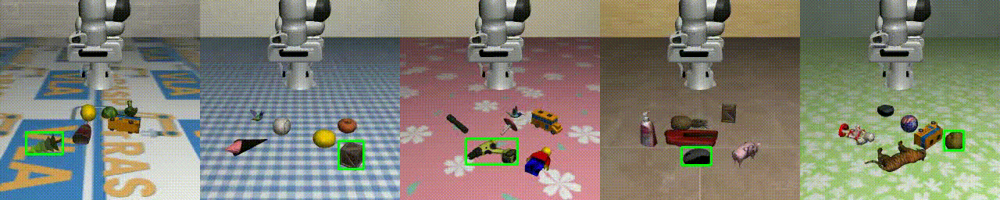
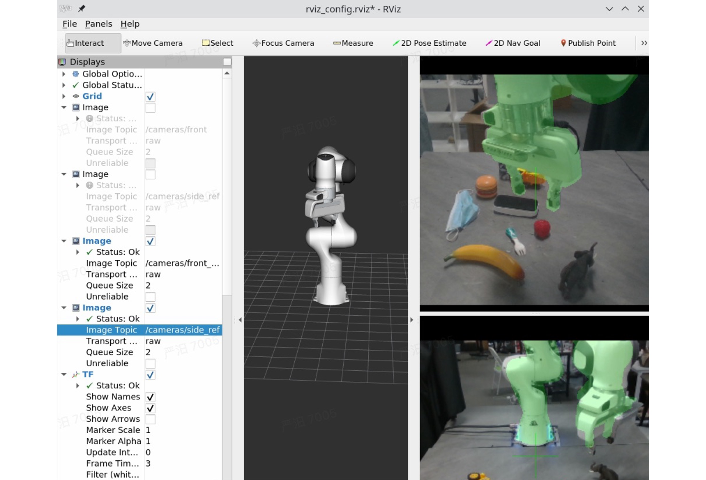

# GraspVLA: a Grasping Foundation Model Pre-trained on Billion-scale Synthetic Action Data

[](https://arxiv.org/pdf/2505.03233)
[](https://pku-epic.github.io/GraspVLA-web/)

[**Model Server**](#model-server) | [**Train on SynGrasp-1B**](#Train-on-SynGrasp-1B) | [**Simulation Playground**](#simulation-playground) | [**Real World Control Interface**](#real-world-control-interface)

We present a cost-effective pretraining paradigm for VLA models using only synthetic data, achieving direct sim-to-real transfer and strong zero-shot generalizability for robotic grasping. Key contributions include:

- **SynGrasp-1B**: a billion-frame synthetic grasping dataset, spanning 240 object categories and 10,000+ objects.

- **GraspVLA**: a VLA model pretrained on SynGrasp-1B that achieves zero-shot generalization to real-world grasping without fine-tuning.

- **Unified CoT Framework**: GraspVLA integrates autoregressive perception and flow-matching-based action generation into a single reasoning process, enabling joint training on synthetic action data and internet-scale semantic data for open-vocabulary grasping.



## Latest Updates
- [2026-8-19] Release the SynGrasp-1B dataset and update the training framework.
- [2025-12-29] 🎉🎉🎉 We release [StereoVLA](https://shengliangd.github.io/StereoVLA-Webpage/), a VLA model powered by stereo vision and supports flexible deployment with high tolerance to camera pose variations.
- [2025-07-25] Release the GraspVLA model, [simulation playground](https://github.com/MiYanDoris/GraspVLA-playground) and [real world control interface](https://github.com/MiYanDoris/GraspVLA-real-world-controller).
- [2025-07-19] Release the [supplementary material](https://arxiv.org/pdf/2505.03233).

## Model Server

Please follow the steps below to start the model server. We provide the checkpoint of GraspVLA on [huggingface](https://huggingface.co/vegebirrd/GraspVLA). GraspVLA achieves 200ms inference latency using ~9GB of GPU memory when running on a single NVIDIA RTX L40s GPU.

### Step 1: Clone the Repository
```bash
git clone https://github.com/PKU-EPIC/GraspVLA
cd GraspVLA
```

### Step 2: Set Up Python Environment
Install [uv](https://docs.astral.sh/uv/) and synchronize the locked Python environment:
```bash
curl -LsSf https://astral.sh/uv/install.sh | sh
export PATH="$HOME/.local/bin:$PATH"

uv sync --locked
```

### Step 3: Prepare a Checkpoint
Serving requires a complete experiment directory:  

```text
<experiment-dir>/
├── config.json
├── preprocessor.npz
└── checkpoint-<step>/
    └── model.safetensors
```

The configuration and preprocessor must come from the same training experiment as the checkpoint.  

If you want to download our model weight from huggingface:
```bash
pip install -U "huggingface_hub"
# set HF_ENDPOINT if you encounter connection issues:
# export HF_ENDPOINT=https://hf-mirror.com
hf download vegebirrd/GraspVLA
```
The model weight will be placed at `~/.cache/huggingface/hub/models--vegebirrd--GraspVLA/snapshots/e0b642edc7dfdf8e76cb7883320a0bbd85145f53`.  

### Step 4: Launch the Model Server
Run the model server with your desired configuration, for example:
```bash
uv run --no-sync python -u -m vla_network.scripts.serve \
  --port 6666 \
  --path you-path-to-model.safetensors \
  --batch-size 1
```

#### Required arguments:

- `--path` — Path to `checkpoint-<step>/model.safetensors`.
- `--port` — Port number on which the server will listen for incoming requests.

#### Optional arguments:

- `--batch-size` — Maximum inference batch size (default: `1`).
- `--batching-delay` — Maximum request batching delay in milliseconds (default: `80`).
- `--compile` — Enable model compilation (default: False). Speeds up inference (500ms → 
200ms) but adds ~3 minutes to startup time. Recommended for large-scale evaluations (e.
g., LIBERO benchmark).

The server is ready when it logs `start serving`.

### Pretrained LLM Weights

Serving also needs the InternLM backbone (`internlm/internlm2-1_8b`). The loader
uses the following priority:

1. If `$VLA_STORAGE_PATH/ckpt/pretrained/internlm/internlm2-1_8b` exists, load from
   that local directory.
2. Otherwise, download from Hugging Face Hub.

For training, `VLA_STORAGE_PATH` is still recommended because experiment
checkpoints and preprocessors are written to
`$VLA_STORAGE_PATH/ckpt/exp/<exp_name>/`.


### Offline Test and Visualization

With the server running, send a generated mock request and save the predicted
side/front bounding boxes:

```bash
uv run --no-sync python -m vla_network.scripts.offline_test \
  --port 6666 \
  --output visualization/offline_test.png
```

To compare against a recorded request/response pair:

```bash
uv run --no-sync python -m vla_network.scripts.offline_test \
  --port 6666 \
  --input visualization/trial_data.npy \
  --output visualization/comparison.png
```

## Train on SynGrasp-1B

We have released the SynGrasp-1B dataset on [huggingface](https://huggingface.co/datasets/vegebirrd/SynGrasp-1B).

### Step 1: Download the SynGrasp-1B Dataset

```bash
pip install -U "huggingface_hub"
# set HF_ENDPOINT if you encounter connection issues:
# export HF_ENDPOINT=https://hf-mirror.com
DATASET_ROOT=/path/to/SynGrasp-1B
hf download vegebirrd/SynGrasp-1B --repo-type dataset --local-dir "$DATASET_ROOT"
```

### Step 2: Launch Distributed Training with `torchrun`

We provide an example that works for both one and multiple nodes and uses one sample per GPU with gradient accumulation:

```bash
export VLA_STORAGE_PATH=/path/to/storage
DATASET_ROOT=/path/to/SynGrasp-1B
EXP_NAME=<exp_name>

NUM_GPUS=8
NNODES=${NNODES:-1}
NODE_RANK=${NODE_RANK:-0}
MASTER_ADDR=${MASTER_ADDR:-127.0.0.1}
MASTER_PORT=${MASTER_PORT:-9261}
GLOBAL_BATCH_SIZE=384

uv run --no-sync torchrun \
  --nnodes "$NNODES" \
  --nproc-per-node "$NUM_GPUS" \
  --node-rank "$NODE_RANK" \
  --master-addr "$MASTER_ADDR" \
  --master-port "$MASTER_PORT" \
  --module vla_network.scripts.train_vla \
  --exp_name "$EXP_NAME" \
  --train_datasets "$DATASET_ROOT,lerobot_franka_dataset,1" \
  --val_datasets "$DATASET_ROOT,lerobot_franka_dataset,1" \
  --global_bs "$GLOBAL_BATCH_SIZE" \
  --device_bs 1 \
  --num_workers 8 \
  --count_num 10000 \
  --save_step 10000 \
  --max_steps 200000 \
  --deepspeed none \
  --fsdp full_shard \
  --grad_ckpt 1 \
  --pred cot_flow_matching \
  --action_expert 1 \
  --backbone_2d dinosiglip \
  --image_keys left,right \
  --dt 0.3 \
  --proprio_steps 2 \
  --action_steps 4 \
  --max_proprio_dim 7 \
  --max_action_dim 7 \
  --max_goal_dim 6 \
  --reuse_preprocessor 0
```

Key arguments:

- Distributed launch:
  - `--nnodes` — Total number of training nodes.
  - `--nproc-per-node` — Worker/GPU processes started on each node.
  - `--node-rank` — Zero-based index of the current node.
  - `--master-addr`, `--master-port` — Address used by all nodes to form the
    distributed process group.
- Data and experiment:
  - `--exp_name` — Experiment directory name under `ckpt/exp/`.
  - `--train_datasets`, `--val_datasets` — Comma-separated
    `path,dataset_type,weight` specifications. This repository supports
    `lerobot_franka_dataset`.
  - `--num_workers` — DataLoader worker processes per training process.
  - `--count_num` — Number of samples used to estimate normalization
    statistics.
  - `--allow_resume 0/1` — If `1` and the output directory already contains
    checkpoints, resume training from the latest checkpoint in that
    directory.
  - `--ckpt <checkpoint_file>` — Initialize model weights from a
    checkpoint file (for example, a previously saved
    `checkpoint-<step>/model.safetensors`).
  - `--reuse_preprocessor 0` — Recompute and save normalization statistics;
    use `1` when resuming with a compatible existing `preprocessor.npz`.
- Batch size and schedule:
  - `--global_bs` — Effective batch size across all GPUs and gradient
    accumulation steps. It must be divisible by `device_bs × NNODES × NUM_GPUS`。
  - `--device_bs` — Samples processed by each GPU per forward/backward pass.
  - `--max_steps` — Total optimizer-update steps.
  - `--save_step` — Checkpoint interval in optimizer-update steps.
- Memory and distributed state:
  - `--deepspeed none` — Disable DeepSpeed.
  - `--fsdp full_shard` — Shard parameters, gradients, and optimizer states
    across workers.
  - `--grad_ckpt 1` — Reduce activation memory through recomputation.
- Model and prediction:
  - `--pred` — Prediction mode. This repo supports four options:
    - `token_pred` — Autoregressively predict the token sequence (e.g. goal
      and/or bbox tokens depending on supervision), then predict actions
      from the token head.
    - `flow_matching` — Predict actions directly with the flow-matching
      module (no autoregressive goal/bbox token generation). Note: this mode
      is not implemented in `predict()`/serve for now.
    - `cot_bbox_flow_matching` — COT-style bbox: autoregressively predict
      bbox tokens (no goal token), then predict actions with flow matching.
    - `cot_flow_matching` — COT-style: autoregressively predict bbox + goal
      tokens, then predict actions with flow matching.
  - `--action_expert 1` — Enable the separate action-expert transformer.
  - `--backbone_2d dinosiglip` — Use the DINOv2/SigLIP vision backbone.
  - `--image_keys left,right` — Model camera order.
- Temporal and vector dimensions:
  - `--dt` — Time interval in seconds between sampled trajectory steps.
  - `--proprio_steps` — Number of historical/current proprioception steps.
  - `--action_steps` — Number of future actions predicted per sample.
  - `--max_proprio_dim`, `--max_action_dim`, `--max_goal_dim` — Padded vector
    dimensions expected by the model.

### Repository Structure

High-level overview of `vla_network` file-tree:

+ `config/` — Pydantic model/training configuration and command-line overrides.
+ `datasample/` — Base and LeRobot VLA data sample schemas.
+ `dataset/` — LeRobot Franka loading, streaming, mixing, and dataset setup.
+ `model/` — Code for defining and loading the main model structure.
+ `preprocessor/` — Tools for preprocessing raw data into model-ready formats.
+ `scripts/` — Training, serving, and offline server-test entrypoints.
+ `type/` — Data type definitions used in our model.
+ `utils/` — Checkpoint, path, logging, tokenization, and LeRobot streaming helpers.

## Simulation Playground
We provide a simulation playground for GraspVLA here: [GraspVLA-playground](https://github.com/MiYanDoris/GraspVLA-playground). This repository includes both the evaluation code used for GraspVLA in the [LIBERO](https://github.com/Lifelong-Robot-Learning/LIBERO) benchmark and an enhanced playground environment built on top of it. The playground provides an easy-to-use interface to evaluate GraspVLA across diverse objects, layouts, and environments.


## Real World Control Interface
We provide a [real-world control interface](https://github.com/MiYanDoris/GraspVLA-real-world-controller) for deploying GraspVLA in physical environments. This interface enables:

- Zero-shot evaluation on real-world objects.

- Both blocking and non-blocking control modes.

- Real-time visualization of intermediate COT results, including 2D bounding boxes and 3D grasp poses.



## Citation

If you find this work useful, please cite:

```bibtex
@article{deng2025graspvla,
    title={GraspVLA: a Grasping Foundation Model Pre-trained on Billion-scale Synthetic Action Data}, 
    author={Shengliang Deng and Mi Yan and Songlin Wei and Haixin Ma and Yuxin Yang and Jiayi Chen and Zhiqi Zhang and Taoyu Yang and Xuheng Zhang and Wenhao Zhang and Heming Cui and Zhizheng Zhang and He Wang},
    year={2025},
    eprint={2505.03233},
    archivePrefix={arXiv},
    primaryClass={cs.RO},
    url={https://arxiv.org/abs/2505.03233}
}
```

[](LICENSE)
